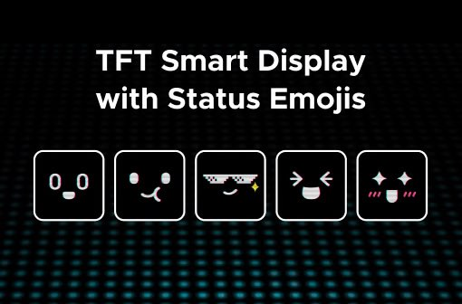
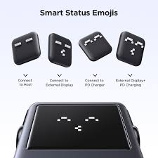

# AKF Winter Wonderland Trivia Booth: Full Plan and History

Owner: Zakir (booth lead), with help from AJ
Event: AKF Winter Wonderland (Ismaili community event)
Booth: Trivia that teaches people what the Aga Khan Foundation (AKF) does
Audience: everyone from 1st graders to adults
Status: planning done, demo app next

---

## 1. What AKF is (background for questions)

- The Aga Khan Foundation is a private, non-profit international development agency. Aga Khan IV founded it in 1967. It is based in Geneva.
- It works in 17 countries across Africa, Asia, Europe, the Middle East and North America.
- It focuses on the root causes of poverty, with an emphasis on women and girls.
- Focus areas: agriculture and food security, civil society, climate resilience, early childhood development, education, health and nutrition.
- Its early childhood programs reached 2.3 million children in 2025.
- Its education programs reached 730,000 learners in 2025.
- AKF is part of the Aga Khan Development Network (AKDN).
- AKF USA raises money and builds partnerships in the US.

Sources: akdn.org (AKF USA page), the.akdn (AKF Education), akfusa.org FAQs.

---

## 2. What we have

| Item | Details |
|---|---|
| Display | Rolling TV monitor (16:9). Its speakers are bad. It has an aux jack. |
| Laptop | M2 MacBook Air, 8 GB RAM, Safari |
| Camera | iPhone on a tripod, used through Continuity Camera, ultra-wide lens |
| Backup cameras | Pixel 9 Pro (main backup), Pixel 6a (spare) |
| Furniture | Table |
| Content | 30 trivia questions (still need to be sent) |
| People | Zakir plus a partner |

---

## 3. Timeline of ideas (including the ones we dropped)

### Idea 1: Kahoot-style phone quiz. DROPPED
- How it works: questions on the TV, everyone answers on their phones.
- Why we dropped it: people stare at their phones instead of talking to us. Everyone has to wait for the round to start. There's no room for hosts to give feedback.
- Simulation: about 40 players in 3 hours, fun score 4.3/10.

### Idea 2: Fully automatic camera system. DROPPED as the core
- How it works: the camera identifies each person, gives them a team color, and the app tracks and scores everything by itself.
- Why we dropped it: tracking in a crowd is fragile. Kids move, the lighting is bad, and people overlap. If a color jumps to the wrong person and that decides the score, the fun dies and we end up debugging at the booth.
- Simulation: about 64 players, fun score 3.4/10 (because of breakdowns).
- Correction along the way: Claude first raised a privacy concern about filming kids. AJ explained that nothing is recorded: a lightweight script just detects people live and draws a colored marker over their heads. Claude agreed this is much less of a privacy issue. The remaining worry is tracking accuracy, not recording.

### Idea 3: Hybrid. CHOSEN
- The camera does the visual magic: a live mirror, floating "kites" over heads, confetti bursts.
- Humans do the scoring: Zakir taps a hotkey for the team that's right.
- If the camera glitches, turn it off and the game keeps going.
- Simulation: about 68 players, fun score 8.2/10.

### Simulation note
The inputs were made up: 3-hour event, about 400 people walking past, guessed stop rates, failure rates and wait tolerance. Use it to compare the options, not as a forecast.

### Idea 4: Two phones streaming to the laptop. PARKED
- A second camera makes the software much harder.
- First try the ultra-wide lens and moving the tripod farther back or higher.
- Keep the Pixel 9 Pro as a backup only.

### Idea 5: Audio. OPTIONAL
- The TV speakers are awful, so the app must work fine muted.
- Bring a small aux or Bluetooth speaker (about $20) for a chime on correct answers and soft winter music.

---

## 4. Physical booth setup

```
            [ Rolling TV monitor ]   [ iPhone on tripod, ultra-wide ]
  [ Table + MacBook ]
                 +-----------------------------------+
                 |        TAPED PLAY SQUARE          |   Partner stands
                 |   8 to 10 ft wide, 8 to 10 ft     |   out front with
                 |   from tripod. 3 to 7 players     |   the teams
                 +-----------------------------------+
                 [   Waiting line (can watch TV)    ]
```

- 3 to 7 players at once, split into 2 or 3 color teams.
- Seven people shoulder to shoulder need 8 to 10 feet of width in the frame. Check this with friends beforehand.
- Swap groups when people are waiting.
- Laptop: keep it cool and give it airflow, since the M2 Air has no fan and slows down when hot. Close other tabs.
- iPhone: keep it plugged in, because streaming video drains the battery fast.

---

## 5. Round flow (about 2 to 3 minutes)

1. The group steps into the square and gets team colors (wristbands, stickers or cards).
2. The question appears on the TV and Zakir reads it out loud.
3. Teams huddle, then shout the answer or hold up a card.
4. Zakir taps the winning team's hotkey. Confetti fires over their kites and the score animates.
5. An AKF fact card shows, and the partner explains it in one sentence.
6. Prizes (candy or stickers), then the next question or the next group.

Golden rule: the camera is for show and the scoring stays human.

---

## 6. TV screen layout (16:9)

```
+------------------------+----------------------+
|  LIVE CAMERA (16:9)    |                      |
|  kites + confetti      |   QUESTION PANEL     |
+------------------------+   big text, A-D,     |
|  SCOREBOARD            |   then fact card     |
|  big team bars         |                      |
+------------------------+----------------------+
```

- The camera panel is 16:9 so the phone's landscape feed fits with no bars or stretching.
- Question and scoreboard panels were made bigger after Zakir/AJ's feedback.
- If the camera feels too small at the test run, make it bigger and shrink the scoreboard.

---

## 7. NEW: Presenter view (like PowerPoint)

Two screens from one laptop:

**TV screen ("Audience view")**
- Camera, question, scoreboard and the mascot. Nothing else.
- No mouse cursor, no buttons, no answers shown early.

**Laptop screen ("Host view")**
- A mini live preview of exactly what the TV shows.
- The correct answer and host notes (the fact to say out loud and the kid-friendly version).
- Big buttons: next/previous question, reveal answer, show fact card, +1 / -1 per team, undo, reset round, new group.
- Camera on/off, kites on/off, confetti test, sound on/off.
- A question list to jump to any question, plus a difficulty filter (Kids / Everyone / Hard).
- A timer (start, pause, add 10 seconds).
- Hotkeys for everything (1 to 4 = score team, Space = reveal, arrow keys = next/previous, C = camera).

**How it works technically (for the build)**
- The TV is an extended display. In macOS display settings, use "Extend", not "Mirror".
- The app opens two Safari windows: host.html on the laptop and audience.html fullscreen on the TV.
- Both windows talk instantly through BroadcastChannel (built into Safari), so no internet or server is needed.
- The camera and detection run only in the audience window, so the laptop doesn't process video twice. The host preview can show a lower-quality copy, or just a still image.

---

## 8. NEW: Look and feel for ages 6 to adult

### Fonts (free, Google Fonts)
- **Headings and questions: Fredoka.** Round, bubbly, very readable for young kids.
- **Big numbers and scores: Lilita One** (or Fredoka Bold). Chunky and game-show-like.
- **Small text and the host view: Nunito.** Friendly and clean.
- Download the fonts so they work offline. Don't rely on venue Wi-Fi.

### Colors
- Winter base: snowy white, ice blue, deep night navy.
- Team colors: Red, Blue, Green, Gold. They must be bright and easy to tell apart, and should match the physical wristbands exactly.

### Mascot: a snowball buddy (working name "Flurry")
- A round snowball body with two oval eyes, a big smile, maybe a little scarf in AKF green.
- Lives in a corner of the TV and reacts to what happens:
  - Idle: blinks, bobs gently, and snowflakes fall around it.
  - Question shown: leans in, eyes look at the question.
  - Thinking time: taps its foot, with a countdown bubble.
  - Correct: jumps, spins and throws confetti.
  - Wrong or nobody got it: a little wobble and an "Ooh, so close!" bubble (always kind, never mean).
  - Fact card: holds up a sign with "Did you know?"
- Drawn in code (SVG plus CSS animation), so it's light on the laptop and needs no image files.
- Speech bubbles carry the instructions, so young kids can follow without reading much.

### Keeping little kids hooked
- Big pictures or emoji on every question, so non-readers can follow.
- Picture answer choices for the youngest kids (e.g. "Which one is a school?").
- Very short rounds and something moving all the time (snow, mascot, bars growing).
- Everyone wins something: candy for all, the leaderboard for bragging rights.
- Physical answers: hold up a colored card, stand on a side, or shout. Not just talking.
- A countdown bar that drains, so kids feel the tension.

### Mascot update (Zakir's reference pictures)
- New style: a little rounded-square "screen buddy" with a simple glowing face on a dark background, like the status-emoji displays Zakir shared. This replaces the snowball idea.
- The face is a few white or ice-blue shapes: oval eyes, a small mouth, and sometimes sparkles.
- It's our own design, drawn in code (SVG or a pixel grid), with a soft glow and a frosty winter tint.
- Expressions mapped to game moments:
  - Idle: plain oval eyes that blink now and then.
  - Question up: eyes look toward the question panel.
  - Thinking time: eyes look side to side.
  - Correct: squeezed > < eyes and a big grin, then sparkles and confetti.
  - Cool streak (a team gets 3 in a row): pixel sunglasses slide down.
  - Wrong or nobody got it: a little wobbly smile with a tongue out, saying "So close!"
  - Fact card: sparkle eyes and blush, saying "Did you know?"
- Reference pictures from Zakir:

  

  

- Size: about the height of the scoreboard, sitting between panels so every age group sees it.

### Celebrations
- Confetti bursts right above the winning team's kites (canvas-confetti library, about 6 KB, can fire from any screen position).
- The team's score bar grows with a bounce.
- Snow flurry or a sparkle wipe between questions.
- Optional sound: a chime, a drumroll for reveals, applause.

---

## 9. Tech stack ideas for the demo app

- Plain web app (HTML/CSS/JS, or React/Vite) running locally on the Mac in Safari. Electron is optional later.
- Person detection: MediaPipe or TensorFlow.js pose detection (runs in the browser, nothing leaves the laptop).
- Overlay: canvas drawn over the video. A kite floats above each detected head (nose/shoulder points).
- Confetti: canvas-confetti, fired at the kite's x/y position.
- Sync: BroadcastChannel between host and audience windows.
- Data: questions in a simple JSON file (question, choices, answer, fact, kid version, emoji, difficulty).

### Build order (so it always works)
1. Layout, questions, scoring and hotkeys, with NO camera. The game must already be fun at this stage.
2. Presenter view: host window plus audience window in sync.
3. Mascot and animations.
4. Live camera panel (just video).
5. Kites over heads, plus confetti at their positions.
6. Sound (optional).

---

## 10. Errors, hiccups and corrections today

- The first plan suggested no camera tracking because of privacy. AJ clarified that nothing is recorded, and the plan changed to the hybrid.
- Google account: connected account was confirmed correct (email addresses redacted for the public repo).
- Google Doc created: "AKF Winter Wonderland Trivia Booth: Info Sheet" (in that Drive).
- The Claude "whiteboard" came out as a sectioned page, not a free drag-around canvas. The user wanted something like Apple Freeform.
- Researched free whiteboards: Miro (chosen, 3 editable boards free, Claude connector), Excalidraw (free, no account, but sketchy look and no official connector), FigJam (free has 3 files, but only 20 MCP calls/month).
- Miro board created: "AKF Winter Wonderland Trivia Booth", with six sections: floor plan, TV layout, round flow, gear, checklist, simulation.
- The TV layout was changed to give the question and score panels more space and keep the camera at 16:9.
- AJ handed the project to Zakir, who now leads it.

---

## 11. Checklists

### Gear to bring
- [ ] MacBook plus charger
- [ ] iPhone, tripod, charging cable (long)
- [ ] Pixel 9 Pro backup
- [ ] HDMI or USB-C adapter for the TV
- [ ] Small speaker plus aux cable (optional)
- [ ] Floor tape
- [ ] Team wristbands or stickers in 4 colors
- [ ] Colored answer cards
- [ ] Candy and stickers
- [ ] Paper copy of all 30 questions

### Before the event
- [ ] Test Continuity Camera in Safari
- [ ] Make sure the app works fully offline (fonts and libraries downloaded)
- [ ] Test run with about 7 friends in frame
- [ ] Measure the tape box using the ultra-wide view
- [ ] Check venue power and Wi-Fi
- [ ] Practice the hotkeys

### Open items
- [ ] Send the 30 questions
- [ ] Fact-check them and add kid-friendly versions and emoji
- [ ] Pick team colors to match the wristbands
- [ ] Final name and look for the mascot
- [ ] Build the demo app in Claude Code
